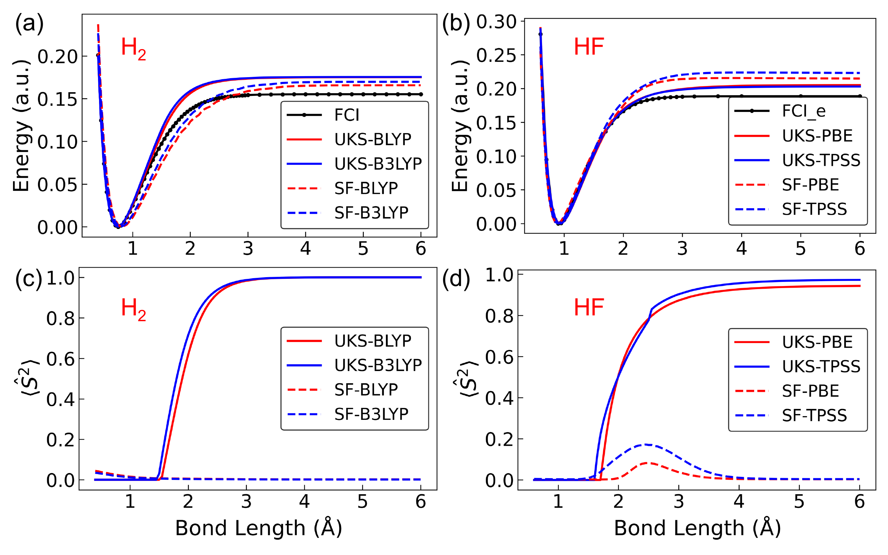

# Noncollinear Spin-Flip TDDFT for Potential Energy Surface Crossings: Conical Intersections and Spin Crossings

Zhang et al., *J. Chem. Theory Comput.* **21**, 11550–11561 (2025). [Article and Supporting Information](https://doi.org/10.1021/acs.jctc.5c01272)

## Files

| Result | Files |
| --- | --- |
| [Figure 2a and Tables 1, 5, S1](meci/functionals/) | Optimized conical intersection geometries for ethylene, PSB3 and styrene, grouped by functional. [Reference structures](meci/reference/) |
| [Tables 4 and S2](meci/basis/) | Ethylene optimizations grouped by basis set. Each directory contains the input, job log and optimized geometry (`meci.xyz`). |
| [Figure 2b](fig-2b/) | Ethylene surface scan. |
| [Figure 3](fig-3/) | Ethylene and stilbene torsion scans. Both stilbene scans read the same 33 geometries. [Scan geometries](fig-3/Stilbene_opt/traj.xyz) |
| [Figure 4 and Table 2](hno/) | HNO structures in `geometry/`, optimizations by method and surface scan in `PES/`. |
| [Figure 5 and Table S3](fig-5/) | The two successive o-nitrophenol search jobs. |
| [Figure 6](fig-6/) | H₃ surface scan. |
| [Table 3](table-3/) | PySCF inputs and logs for cyclazine and heptazine. The Gaussian 16 C.02 calculation cross-checks the PySCF B3LYP spin-conserving gap for heptazine. |
| [Table 6](table-6/) | Vertical excitation energies of the doubly excited states. Inputs and logs are grouped by molecule. |
| [Figure 9](fig-9/) | H₂ and HF dissociation scans by method. |
| [Table S5](table-S5/) | Timing inputs and logs by basis set. `SpeedTest/` is noncollinear and `SpeedTest_Col/` is collinear. |

## Notes on the published results

**Figure 5 and Table S3.** Table S3 gives iteration 9 of the first search. Figure 5b shows iteration 3 of its continuation. Neither geometry met the convergence criteria. [First search](fig-5/30720884/slurm-30720884.out#L562) · [Continuation](fig-5/30721118/slurm-30721118.out#L190)

**Table 2.** The two collinear triplet splittings (ΔE) were transposed. The correct values are 1.641 eV at 111.981° and 1.649 eV at 159.249°. [111.981° single point](hno/ColB3LYP_Ref/try.ipynb) · [159.249° output](hno/ColB3LYP/slurm-555239.out#L132)

**Table 5.** For PSB3/CAM-B3LYP, the S₀ ⟨S²⟩ value was transcribed as 0.071. The output for the reported geometry gives 0.0795. [Job log](meci/functionals/PSB3/CAM-B3LYP/slurm-33231061.out)

**Table 6.** The reported nitrous acid result used aug-cc-pVTZ. With cc-pVTZ, the excitation energy is 7.973 eV and the doubly excited configuration weight is 0.966. [Reported calculation](table-6/nitrous_acid/slurm-33096253.out) · [cc-pVTZ output](table-6/nitrous_acid/cc-pVTZ-check/honotz.log)

**Figure 9.** The solid red H₂ curves labeled UKS-BLYP in panels (a) and (c) used UKS-PBE. The corrected figure below uses UKS-BLYP.

**Table S5.** The first row is labeled `6-31G**`. The calculation used `6-31G*`. [Input](table-S5/SpeedTest/6-31g-star/1.py)

## Software

| PySCF version to use | Calculations |
| --- | --- |
| 2.5.0 | Ethylene and HNO surfaces (Figures 2b and 4b), noncollinear torsion scans (Figures 3b and 3d), o-nitrophenol searches (Figure 5 and Table S3), H₃ surface (Figure 6), collinear HNO calculations (Table 2), Tables 3 and 6, and the five HF FCI scan jobs (Figure 9). |
| 2.8.0 | H₂ FCI reference curve in Figure 9. |
| 2.9.0 | Noncollinear HNO geometry optimization in Figure 4a and Table 2. |
| 2.10.0 | Conical intersection optimizations (Figure 2a and Tables 1, 4, 5, S1 and S2), collinear torsion scans (Figures 3a and 3c), timings (Table S5), and the H₂ B3LYP and HF UKS-PBE scans in Figure 9. |

The PySCF 2.5.0 spin-flip calculations used Libxc 6.1.0 and a modified MCfun 0.2.2. Its spin-flip kernel matches the one in MCfun 0.2.5. [Spin-flip kernel](https://github.com/Multi-collinear/MCfun/blob/af0dc2da10ce6d36b94d5606fd4efc3e70138d2f/mcfun/eval_xc.py#L121-L144)

The PySCF 2.10.0 optimizations and timings used Libxc 7.0.0, [PySCF-Forge `6fcda45`](https://github.com/wtpeter/pyscf-forge/commit/6fcda45813b170a959bc3418706bdb339be4a3d0) and [MCfun 0.2.5 `65a75f9`](https://github.com/wtpeter/MCfun/commit/65a75f97f5203c42736d4a28054c89cf2d078a6f).
