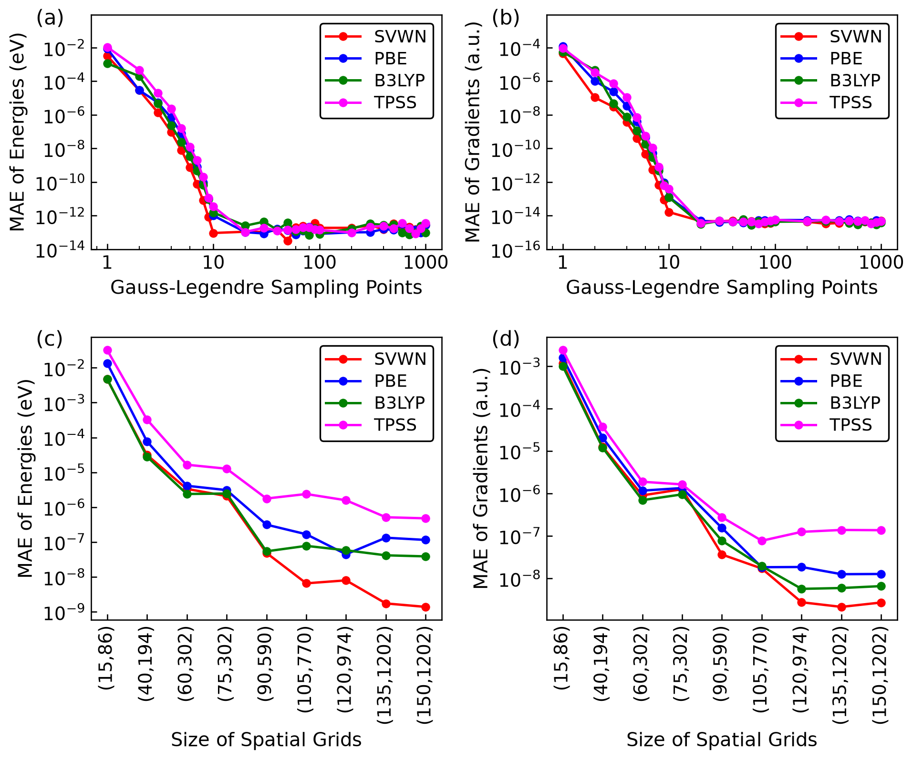

# Zero Excitation Energy Theorem and the Spin-Flip Kernel

Wang et al., *J. Chem. Theory Comput.* **21**, 6905–6921 (2025). [Article](https://doi.org/10.1021/acs.jctc.5c00714)

## Files

| Result | Files |
| --- | --- |
| [Tables 1 and 10 · Hydrogen rings](hydrogen-rings/) | `H3/` and `H5/` each contain one run covering both tables. |
| [Table 2 · Open-shell molecules](open-shell/) | One folder per system. `O2Trip/` and `O2Quin/` are triplet and quintet O₂. `CO2/` is CO₂⁻. |
| [Table 3 · Methanol](methanol/) | `tddft/` and `tda/` correspond to the two column groups in Table 3. |
| [Figure 4 · HCHO](convergence/) | [quadrature/](convergence/quadrature/) is the Gauss–Legendre point-count scan for (a, b). [spatial-grid/](convergence/spatial-grid/) is the spatial integration grid scan for (c, d). |
| [Figure 5 and Tables 4–6 · Nitrosomethane](nitrosomethane/) | Within each functional, `2/` is the S₁ trajectory and `3/` is the S₂ trajectory. [B3LYP/S1.npy](nitrosomethane/B3LYP/S1.npy) and [B3LYP/S2.npy](nitrosomethane/B3LYP/S2.npy) give the state energies for (a) and (b), respectively. |
| [Figure 6 and Table 7 · Naphthoquinones](naphthoquinone/) | `18NQ/` and `27NQ/` are organized by functional. Figure 6 uses the [1,8-NQ singlet](naphthoquinone/18NQ/B3LYP/Singlet.xyz) and [2,7-NQ triplet](naphthoquinone/27NQ/B3LYP/Triplet.xyz) B3LYP geometries. |
| [Figure 7 and Table 8 · Exchange coupling](exchange-coupling/) | `Cu2Cl6/` is Cu₂Cl₆²⁻ and `4VV/` is the 4(V–V) complex. |
| [Figure 8 · Dissociation curves](dissociation/) | [H2/](dissociation/H2/) gives panel (a) and [HF/](dissociation/HF/) gives panel (b). For HF, the FCI bond lengths and energies come from `FCI/Results/{r,e}.npy` at 0.60–3.60 Å and `FCI_{r,e}.npy` at 4, 5 and 6 Å. |
| [Table 11 · CH₂ kernels](ch2-kernels/) | Blocks I, II and III in `631G.log` correspond to the columns “Kernel I”, “Kernel II” and “eq 26”, respectively. |

## Notes on the published results

**Table 3.** Both analyses used `sfu_` (spin-flip-up) for the energy difference. Footnote b incorrectly identifies the channel as spin-flip-down (`sfd_`). For TDDFT the two channels agree at the published precision. [TDDFT analysis](methanol/tddft/Script.ipynb) · [TDA analysis](methanol/tda/Script.ipynb)

**Figure 4 correction.** Published panels (b) and (d) reuse the energy errors from (a) and (c), expressed in hartree. The corrected panels use the saved gradients. At 100 quadrature points the largest gradient MAE is 5.7 × 10⁻¹⁵ hartree/bohr. The redraw script was written for this archive. [Redraw script](convergence/plot_corrected.py)



**Equation (44).** In the first integral, the term containing the gradient of the first orbital product was typeset twice. The corrected equation is

```math
\begin{aligned}
K_{\mu\nu,\rho\sigma}^{x,x}
&= \int \biggl\lbrace
   \phi_{\mu}^{*}\phi_{\nu}\,\phi_{\sigma}^{*}\phi_{\rho}
   \frac{\partial^{2}\varepsilon_{\mathrm{xc}}}{\partial m_{x}\,\partial m_{x}}
\\
&\qquad + \sum_{\alpha} \nabla_{\alpha}(\phi_{\mu}^{*}\phi_{\nu})\,\phi_{\sigma}^{*}\phi_{\rho}
   \frac{\partial^{2}\varepsilon_{\mathrm{xc}}}{\partial m_{x}\,\partial(\nabla_{\alpha} m_{x})}
\\
&\qquad + \sum_{\alpha} \phi_{\mu}^{*}\phi_{\nu}\,\nabla_{\alpha}(\phi_{\sigma}^{*}\phi_{\rho})
   \frac{\partial^{2}\varepsilon_{\mathrm{xc}}}{\partial m_{x}\,\partial(\nabla_{\alpha} m_{x})}
\\
&\qquad + \sum_{\alpha\beta}
   \nabla_{\alpha}(\phi_{\mu}^{*}\phi_{\nu})\,\nabla_{\beta}(\phi_{\sigma}^{*}\phi_{\rho})
   \frac{\partial^{2}\varepsilon_{\mathrm{xc}}}{\partial(\nabla_{\alpha} m_{x})\,\partial(\nabla_{\beta} m_{x})}
   \biggr\rbrace\,\mathrm{d}\mathbf{r}
\\[4pt]
&= \int \phi_{\mu}^{*}\phi_{\nu} \biggl\lbrace
   \frac{\partial^{2}\varepsilon_{\mathrm{xc}}}{\partial m_{x}\,\partial m_{x}}\,\phi_{\sigma}^{*}\phi_{\rho}
\\
&\qquad - \sum_{\alpha} \biggl(
   \nabla_{\alpha}
   \frac{\partial^{2}\varepsilon_{\mathrm{xc}}}{\partial m_{x}\,\partial(\nabla_{\alpha} m_{x})}
   \biggr)\,\phi_{\sigma}^{*}\phi_{\rho}
\\
&\qquad - \sum_{\alpha\beta} \nabla_{\alpha} \biggl[
   \frac{\partial^{2}\varepsilon_{\mathrm{xc}}}{\partial(\nabla_{\alpha} m_{x})\,\partial(\nabla_{\beta} m_{x})}
   \nabla_{\beta}(\phi_{\sigma}^{*}\phi_{\rho})
   \biggr] \biggr\rbrace\,\mathrm{d}\mathbf{r}.
\end{aligned}
```

**Nitrosomethane starting geometry (§5.1).** The S₀ starting geometry was optimized with B3LYP/6-31G(d), although the article lists B3LYP/cc-pVTZ. This difference is expected to have little effect on the main conclusions.

## Software

- **Noncollinear (H₃ and H₅).** PySCF 2.8.0, Libxc 7.0.0, NumPy 1.26.4, SciPy 1.13.1, Python 3.9.13 and MCfun 0.2.2.
- **Spin-flip.** The HCHO, naphthoquinone and exchange-coupling jobs used PySCF 2.5.0, MCfun 0.2.2 (local build with the spin-flip kernel derivative aligned with MCfun 0.2.5), Libxc 6.1.0, NumPy 1.22.3, SciPy 1.10.1 and Python 3.8.19. The CH₂ kernel analysis used PySCF 2.8.0, NumPy 1.26.4 and SciPy 1.13.1. In PySCF-Forge's `pyscf/sftda/uks_sf.py`, we changed the real-part test in `pickeig` from `w.real > -1e-3` to `w.real > self.positive_eig_threshold`. [Upstream solver](https://github.com/pyscf/pyscf-forge/blob/b247f0208946e58d4d88131bf6cf8a43e1465980/pyscf/sftda/uks_sf.py#L144-L148)

Geometry optimizations used Gaussian 16 C.02 or PyBerny 0.6.3. Add `common/` to `PYTHONPATH` for inputs that import `rotate` or `tools`.
